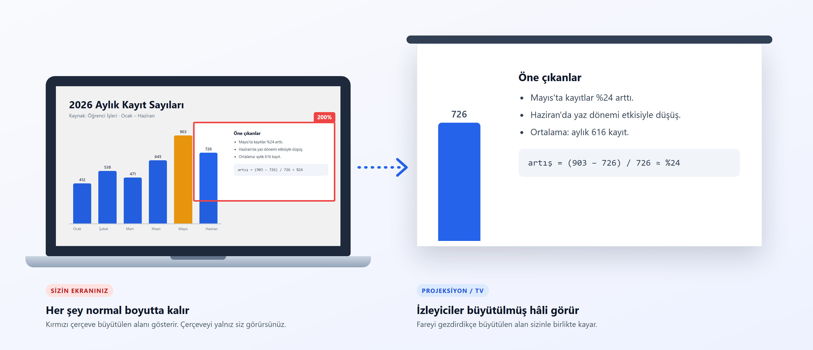
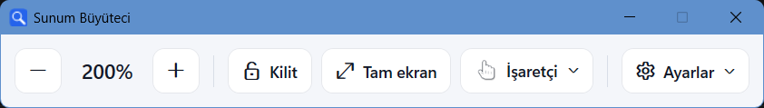
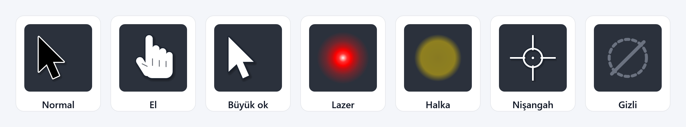

<div align="center">


# Sunum Büyüteci

**Sunum yaparken ekranın bir bölümünü yalnız izleyicilere büyütün. Sizin ekranınız olduğu gibi kalır.**

[](https://github.com/gunhanmehmetakif/sunum-buyuteci/releases)  [](LICENSE)

### [⬇ İndir (SunumBuyuteci.exe)](https://github.com/gunhanmehmetakif/sunum-buyuteci/releases/latest)

Kurulum gerekmez · .NET gerekmez · Tek dosya

<br>



</div>

## Neden?

Bir derste hoca sunum yaparken Windows Büyüteci'ni kullanıyordu. Büyüteç kendi ekranının üzerinde çalıştığı için sürekli büyüt / tam ekran arasında gidip geliyor, büyütünce de dışarıda kalan kısmı kendisi göremiyordu. Bu proje o sorunu çözmek için yapıldı.

| | Windows Büyüteci | Sunum Büyüteci |
|---|:---:|:---:|
| Sizin ekranınız büyütülür mü? | Evet, ekranı kaybedersiniz | **Hayır, normal kalır** |
| Büyütülen alanın dışını görebilir misiniz? | Hayır | **Evet** |
| İzleyiciler büyütülmüş hâli görür mü? | Evet | **Evet** |
| Büyütülen alan sizin ekranınızda belli mi? | — | **Çerçeveyle gösterilir (izleyiciler görmez)** |
| İzleyicilere imleç yerine el veya lazer gösterilebilir mi? | Hayır | **Evet, ya da imleç tamamen gizlenir** |

## Özellikler

- **Canlı büyütme:** Projeksiyon/TV'de, fareyi takip eden büyütülmüş görüntü.
- **Görünmez çerçeve:** Neresinin büyütüldüğünü yalnız siz görürsünüz.
- **Kontrol penceresi:** Tek tıkla büyüt, küçült, kilitle, tam ekrana dön, işaretçiyi seç. İzleyiciler bu pencereyi de görmez.
- **Kısayollar:** Klavyeden ve fare tekerleğinden yakınlaştırma. AltGr ile yazılan `@` gibi karakterleri bozmaz.
- **İşaretçi görünümü:** İzleyiciler imleç yerine el, lazer, halka gibi bir işaretçi görür ya da hiç görmez. Sizin imleciniz değişmez. *(yeni)*
- **Çerçeve kilidi:** Büyütülen alanı sabitleyip fareyi serbestçe kullanın.
- **Kablo dostu:** Projeksiyon kablosu çıkıp takılınca kaldığı yerden devam eder.



## İşaretçi görünümü

Projeksiyonda Windows imleci küçük kalır ve uzaktan zor seçilir. Gerçek lazer kalemler de TV ve LED ekranlarda görünmez. Sunum Büyüteci, izleyicilerin gördüğü imleci sizin seçtiğiniz bir işaretçiyle değiştirir:



- **Sizin ekranınızda imleç normal kalır.** Tıklarken hassasiyet kaybolmaz; değişen yalnız izleyicilerin gördüğüdür.
- **Boyut:** Küçük, Orta veya Büyük. İşaretçi yakınlaştırmayla büyüyüp bulanıklaşmaz, hep net kalır.
- **Seçmek için:** Kontrol penceresindeki **İşaretçi** düğmesi, simge alanındaki menü veya `Ctrl + Alt + L`. Seçiminiz hatırlanır.
- **Video izletirken:** `Ctrl + Alt + G` ile imleci izleyicilerden gizleyin, aynı kısayolla geri getirin.

## Kullanım

1. Projeksiyonu veya TV'yi bağlayın, `Win + P` → **Uzat**'ı seçin.
2. `SunumBuyuteci.exe`'yi açın. Ekranlarda büyük numaralar belirir; sunum ekranını seçip **Başlat**'a basın.
3. Kontrol penceresinden veya kısayollarla yakınlaştırın.

| Kısayol | İş |
|---|---|
| `Ctrl + Alt + Fare tekerleği` | Yakınlaştır / uzaklaştır |
| `Ctrl + Alt + ↑ / ↓` (veya numpad `+ / -`) | Yakınlaştır / uzaklaştır |
| `Ctrl + Alt + 0` | Tam ekran (1x) |
| `Ctrl + Alt + K` | Çerçeveyi kilitle / çöz |
| `Ctrl + Alt + L` | İşaretçi görünümünü değiştir (El, Lazer, …) |
| `Ctrl + Alt + G` | İşaretçiyi gizle / geri getir |
| `Ctrl + Alt + Q` | Çıkış |

PowerPoint ile kullanım ve ayrıntılar: **[Kullanım kılavuzu](docs/KULLANIM.md)**

## Sık sorulanlar

<details>
<summary><b>"Windows bilgisayarınızı korudu" uyarısı çıkıyor.</b></summary>

Uygulama imzasız olduğu için SmartScreen uyarı verir. **Ek bilgi → Yine de çalıştır**'a basın. Kaynak kodun tamamı bu depoda.
</details>

<details>
<summary><b>"Sunum ekranı bulunamadı" diyor.</b></summary>

Windows ekran modu **Yinele** ise iki ekrana farklı görüntü verilemez. Uygulamadaki **Uzat'a geç** düğmesine basın veya `Win + P` → **Uzat** seçin.
</details>

<details>
<summary><b>Bazı pencereler projeksiyonda siyah görünüyor.</b></summary>

Yönetici izni (UAC) pencereleri ve korumalı videolar (Netflix vb.) Windows tarafından kopyalanamaz.
</details>

<details>
<summary><b>Bildirimlerim izleyicilere görünür mü?</b></summary>

Evet, sizin ekranınızda görünen her şey projeksiyona da yansır. Sunumdan önce **Rahatsız etmeyin**'i açın.
</details>

## Kaynaktan derleme

[.NET 10 SDK](https://dotnet.microsoft.com/download) gerekir.

```
dotnet publish src\SunumBuyuteci\SunumBuyuteci.csproj -c Release -r win-x64 --self-contained true -p:PublishSingleFile=true -p:IncludeNativeLibrariesForSelfExtract=true -p:EnableCompressionInSingleFile=true -p:DebugType=none -o dist
```

## Katkı ve hata bildirimi

Bir sorun gördüyseniz veya fikriniz varsa [Issues](https://github.com/gunhanmehmetakif/sunum-buyuteci/issues/new/choose) sayfasından yazın.

## Lisans

[MIT](LICENSE)
